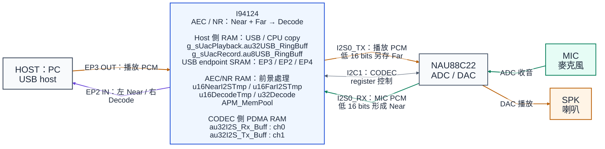
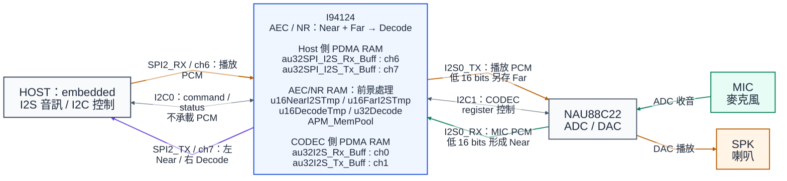

# I94124 NAU88C22 APM Demo v0.0.2a

本專案提供 I94100／NAU88C22 的 USB UAC 與 I2C/I2S 音訊範例，使用相同的 Colsonic APM library、參數 profile 與記憶體配置。兩種介面的傳輸與處理觸發條件不同，正常上行均為左 Near、右 Decode。

- `v0.0.2a` 是 demo 基底標籤，來源為 `Nuvoton_demo_AEC_16k_0.0.2a` 範例名稱。
- Library 以內嵌識別字串與 SHA-256 追溯，與 demo 基底標籤分別記錄。

## 完整流程文件

| 文件 | 內容 |
|---|---|
| **[USB 完整流程](SampleCode/Template/Nuvoton_demo_AEC_16k_0.0.2a.md)** | PC 播放 → 喇叭／Far、麥克風／Near → APM → USB 錄音，以及 endpoint／RAM／PDMA 流程 |
| **[I2C/I2S 完整流程](SampleCode/Template/Colsonic_16k_I2S_I2C.md)** | Host I2S 音訊、正常／bypass 模式、buffer 流程，以及完整 I2C command 表與封包範例 |

兩份文件與 README 使用 repository 相對連結；目錄結構一併上傳至 GitHub 後，可從首頁開啟完整文件及其中的 Mermaid 流程圖。

## 1. 訊號與演算法名詞

| 名詞 | 本程式的實際來源／用途 | 容易誤解的地方 |
|---|---|---|
| **Near** | 麥克風經 CODEC ADC、I2S0 RX 接收後，取每個 word 的低 16 bits，尚未經 APM 處理 | 包含現場人聲、喇叭回音及環境雜音；不是只有人聲 |
| **Far** | 準備送往 CODEC 的 I2S0 TX buffer，取低 16 bits，作為播放參考 | 是數位播放訊號；不是另一顆麥克風，也不是喇叭實際聲壓量測 |
| **Decode** | `Colsonic_apm_proc(Near, Far, Decode)` 的處理後 PCM 輸出 | 不是 MP3 解碼、語音文字或語音辨識結果 |
| **AEC** | 以 Far 為參考，處理 Near 裡與播放訊號相關的回音 | 若播放聲沒有經過此板的播放路徑，Far 可能沒有該背景音 |
| **NR／NS** | Library 內的噪音抑制處理 | 現有 I2C command 沒有獨立的 NR 開關；`0x13` 是輸出選擇，見 I2C 文件 |
| **I2S TX／RX** | 以 I94124 為基準：I2S0_TX 傳向 CODEC／SPK，I2S0_RX 接收 CODEC／MIC；SPI2_TX/RX 是另一側的 Host 音訊介面 | TX／RX 並非以 CODEC 或 embedded host 為觀察點 |
| **USB OUT／IN** | 以 USB host 為基準：EP3 OUT 為播放下行，EP2 IN 為錄音上行；EP4 IN 為 playback feedback | USB endpoint 名稱與 MCU 的 TX／RX 視角不同 |
| **`u32Decode`** | 已封裝兩個觀察聲道的 stereo RAM queue；正常為 Near／Decode，bypass 為 Far／Near | 單聲道 Decode 直接結果在 `u16DecodeTmp`，不是這整個 stereo queue |

APM 為封閉的 `.lib`：

- 應用層可確認輸入、輸出與呼叫條件。
- 內部雙講偵測、抑制強度及各模組行為，需依 library 定義及實際量測確認。

### 訊號來源與上行聲道

- 設備由左至右排列為 Host、I94124、NAU88C22；MIC 在右上、SPK 在右下。箭頭表示實際資料方向。
- `I2S0_TX/RX` 與 `SPI2_TX/RX` 均以 **I94124** 為觀察點；USB `OUT/IN` 則以 USB host 為觀察點。
- 設備在圖上的位置與 stereo 左／右聲道是不同概念；Host 收到的聲道內容另標在上行箭頭。

```mermaid
%%{init: {"theme": "base", "flowchart": {"htmlLabels": false, "curve": "linear", "nodeSpacing": 35, "rankSpacing": 65, "padding": 16, "wrappingWidth": 420}, "themeVariables": {"fontFamily": "Microsoft JhengHei, Arial, sans-serif", "fontSize": "20px", "primaryTextColor": "#1e293b", "lineColor": "#475569", "edgeLabelBackground": "#ffffff"}, "themeCSS": "text, tspan, .nodeLabel, .edgeLabel {\n  font-family: \"Microsoft JhengHei\", Arial, sans-serif !important;\n}\n", "htmlLabels": false}}%%
flowchart LR
    HOST["HOST<br/>PC USB 或 embedded I2S<br/>上行：左 Near / 右 Decode"]
    MCU["I94124<br/>AEC / NR：Near + Far → Decode<br/><br/>Near：I2S0_RX 低 16 bits<br/>Far：I2S0_TX 低 16 bits"]
    CODEC["NAU88C22<br/>ADC / DAC"]
    MIC["MIC<br/>麥克風"]
    SPK["SPK<br/>喇叭"]
    HOST -->|"播放 PCM"| MCU
    MCU --> HOST
    CODEC -->|"I2S0_RX：MIC PCM<br/>低 16 bits 形成 Near"| MCU
    MCU -->|"I2S0_TX：播放 PCM<br/>低 16 bits 另存 Far"| CODEC
    MIC -->|"ADC 收音"| CODEC
    %% Layout-only edges retain MIC above SPK; the visible arrows show actual data direction.
    CODEC ~~~ MIC
    CODEC ~~~ MIC
    CODEC -->|"DAC 播放"| SPK
    MCU <-->|"I2C1：CODEC register 控制"| CODEC
    HOST ~~~ MCU
    classDef host fill:#f8fafc,stroke:#334155,stroke-width:2px,font-size:24px
    classDef mcu fill:#eff6ff,stroke:#1d4ed8,stroke-width:2px,font-size:20px
    classDef codec fill:#f8fafc,stroke:#475569,stroke-width:2px,font-size:24px
    classDef near fill:#e6fcf5,stroke:#087f5b,stroke-width:2px,font-size:24px
    classDef far fill:#fff4e6,stroke:#b95c00,stroke-width:2px,font-size:24px
    class HOST host
    class MCU mcu
    class CODEC codec
    class MIC near
    class SPK far
    linkStyle 0,3,7 stroke:#b95c00,stroke-width:2px
    linkStyle 1 stroke:#6741d9,stroke-width:2px
    linkStyle 2,4 stroke:#087f5b,stroke-width:2px
```



[訊號與設備總覽 SVG](docs/images/audio_signal_flow.svg)

### USB UAC 正常輸出

左側 PC 送出 playback PCM，I94124 經 I2S0_TX 送到 CODEC DAC／SPK；MIC 收音經 CODEC ADC、I2S0_RX 回到 I94124。正常錄音為左 Near、右 Decode。



[USB 正常輸出與 RAM SVG](docs/images/audio_channels_normal.svg)

- 圖中 RAM 名稱均屬於 I94124。USB endpoint SRAM 與軟體 ring 以 CPU copy 交接，本程式沒有 USB PDMA channel。
- 播放：EP3 → `g_sUacPlayback.au32USB_RingBuff` → `au32I2S_Tx_Buff` → CODEC／SPK；Far 取實際 TX refill 的低 16 bits。
- 收音：`au32I2S_Rx_Buff` 累積為 `u16NearI2STmp`；Far 由 TX 側另外累積，兩者一起輸入 APM。
- 上行：APM 輸出 `u16DecodeTmp`，與 Near 封裝至 `u32Decode`，再經 `g_sUacRecord.au8USB_RingBuff` → EP2。

### I2C/I2S 正常輸出

左側 embedded host 經 SPI2-I2S 收送 PCM，I2C0 只傳 command／status。CODEC 端仍使用 I2S0_TX 播放、I2S0_RX 收音，正常上行為左 Near、右 Decode。



[I2C-I2S 正常輸出與 RAM SVG](docs/images/audio_i2s_normal.svg)

- Host 下行：SPI2_RX／PDMA ch6 → `au32SPI_I2S_Rx_Buff` → `au32I2S_Tx_Buff` → I2S0_TX／PDMA ch1 → CODEC／SPK。
- Host 上行：I2S0_RX／PDMA ch0 → Near frame／APM → `u32Decode` → `au32SPI_I2S_Tx_Buff` → SPI2_TX／PDMA ch7 → Host。
- `u16NearI2STmp`、`u16FarI2STmp` 儲存 APM 輸入；`u16DecodeTmp` 為單聲道處理結果。`u32Decode` 是封裝後的 stereo queue，並非直接 PDMA buffer。
- PCM buffer 容量、counter 單位與 PDMA descriptor 位址列於後面的 RAM／PDMA matrix。Descriptor 是搬移控制結構，與 PCM buffer 不同。

### I2C/I2S bypass 輸出

I2C command `13 01 00` 選擇左 Far、右 Near；設備、RAM 與 PDMA 路徑維持相同，APM 仍會運算，僅改變上行聲道選擇。USB 不提供可操作的 bypass 入口。

```mermaid
%%{init: {"theme": "base", "flowchart": {"htmlLabels": false, "curve": "linear", "nodeSpacing": 35, "rankSpacing": 65, "padding": 16, "wrappingWidth": 420}, "themeVariables": {"fontFamily": "Microsoft JhengHei, Arial, sans-serif", "fontSize": "20px", "primaryTextColor": "#1e293b", "lineColor": "#475569", "edgeLabelBackground": "#ffffff"}, "themeCSS": "text, tspan, .nodeLabel, .edgeLabel {\n  font-family: \"Microsoft JhengHei\", Arial, sans-serif !important;\n}\n", "htmlLabels": false}}%%
flowchart LR
    HOST["HOST：embedded<br/>I2S 音訊 / I2C 控制"]
    MCU["I94124<br/>APM 仍在運算<br/>上行選擇：Far / Near<br/><br/>RAM 與 PDMA 路徑<br/>與 I2C/I2S 正常模式相同"]
    CODEC["NAU88C22<br/>ADC / DAC"]
    MIC["MIC<br/>麥克風"]
    SPK["SPK<br/>喇叭"]
    HOST -->|"SPI2_RX / ch6：播放 PCM"| MCU
    MCU -->|"SPI2_TX / ch7：左 Far / 右 Near"| HOST
    CODEC -->|"I2S0_RX：MIC PCM<br/>低 16 bits 形成 Near"| MCU
    MCU -->|"I2S0_TX：播放 PCM<br/>低 16 bits 另存 Far"| CODEC
    MIC -->|"ADC 收音"| CODEC
    %% Layout-only edges retain MIC above SPK; the visible arrows show actual data direction.
    CODEC ~~~ MIC
    CODEC ~~~ MIC
    CODEC -->|"DAC 播放"| SPK
    MCU <-->|"I2C1：CODEC register 控制"| CODEC
    HOST <-->|"I2C0：command / status<br/>不承載 PCM"| MCU
    HOST ~~~ MCU
    classDef host fill:#f8fafc,stroke:#334155,stroke-width:2px,font-size:24px
    classDef mcu fill:#eff6ff,stroke:#1d4ed8,stroke-width:2px,font-size:20px
    classDef codec fill:#f8fafc,stroke:#475569,stroke-width:2px,font-size:24px
    classDef near fill:#e6fcf5,stroke:#087f5b,stroke-width:2px,font-size:24px
    classDef far fill:#fff4e6,stroke:#b95c00,stroke-width:2px,font-size:24px
    class HOST host
    class MCU mcu
    class CODEC codec
    class MIC near
    class SPK far
    linkStyle 0,3,7 stroke:#b95c00,stroke-width:2px
    linkStyle 1 stroke:#087f5b,stroke-width:2px
    linkStyle 2,4 stroke:#087f5b,stroke-width:2px
```



[I2C-I2S bypass 輸出 SVG](docs/images/audio_channels_bypass.svg)

## 2. 範例與專案入口

| 項目 | USB UAC 範例 | I2C 控制＋I2S 音訊範例 |
|---|---|---|
| 資料夾 | `Nuvoton_demo_AEC_16k_0.0.2a` | `Colsonic_16k_I2S_I2C` |
| 完整流程、buffer 與操作說明 | [USB 詳細文件](SampleCode/Template/Nuvoton_demo_AEC_16k_0.0.2a.md) | [I2C/I2S 詳細文件與 command 表](SampleCode/Template/Colsonic_16k_I2S_I2C.md) |
| Keil 專案 | [Colsonic_apm.uvprojx](SampleCode/Template/Nuvoton_demo_AEC_16k_0.0.2a/KEIL/Colsonic_apm.uvprojx) | [Colsonic_16k.uvprojx](SampleCode/Template/Colsonic_16k_I2S_I2C/KEIL/Colsonic_16k.uvprojx) |
| Keil target | `Colsonic_apm` | `Colsonic_demo` |
| 外部使用者 | PC，例：GoldWave 錄音／背景音播放 | Embedded host：I2C 下指令、I2S 收送 PCM |
| 音訊入口 | USB playback OUT；CODEC 麥克風 ADC | Host SPI2-I2S RX；CODEC 麥克風 ADC |
| 音訊出口 | CODEC 喇叭；USB record IN | CODEC 喇叭；Host SPI2-I2S TX |
| APM 開始條件 | Host 開啟 USB record interface | 開機 `Misc()` 直接呼叫 `Start_Audio()` |
| APM frame 觸發 | Near、Far ready 後，RX handler 設 `bDoAECReady` | 前景程式只檢查 `bNearReady` |

文件依名詞與聲道 matrix、端到端流程、buffer／PDMA 表及原始碼索引組織。既有 PDF 為較早的匯出內容，架構及操作說明以 Markdown 為準。

### 建置環境

| 項目 | 專案設定 |
|---|---|
| IDE／compiler | Keil µVision 5、Arm Compiler 6.22，以及可建置此映像大小的有效授權 |
| I2C/I2S device pack | `Nuvoton.NuVoice_ISD_DFP.1.0.20` |
| USB device pack | `Nuvoton.AudioSoCs_DFP.1.0.0` |
| Target device | `I94124` |

1. 保留完整 repository 目錄結構，包含根目錄 SDK 與 USB 範例自帶的 SDK。
2. 安裝對應 device pack，開啟上表連結的 Keil 專案與 target。
3. 執行 Rebuild；AXF／BIN 產生於各範例的 `KEIL/obj/`，由 Git 預設忽略。

## 3. 聲道 matrix：上行觀察聲道配置

- 一個 `uint32_t` stereo word 包含兩個 16-bit PCM sample。
- 下表依程式封裝、I2S `EVENLOW` 與 USB little-endian 順序，稱低 16 bits 為左、高 16 bits 為右。
- I2S host 的左右位置以實際 LRCK／slot 設定為準。

| 模式 | 左／word 低 16 bits | 右／word 高 16 bits | `u32Decode` 的封裝公式 | 最後輸出 buffer |
|---|---|---|---|---|
| USB 正常，預設 | **Near：處理前麥克風** | **Decode：處理後** | `(Decode << 16) \| Near` | USB record `au8USB_RingBuff` → EP2 |
| I2C/I2S 正常，`0x13=1`，預設 | **Near：處理前麥克風** | **Decode：處理後** | `(Decode << 16) \| Near` | `au32SPI_I2S_Tx_Buff` → SPI2 TX |
| I2C/I2S bypass，`0x13=0` | **Far：數位播放參考** | **Near：處理前麥克風** | `(Near << 16) \| Far` | `au32SPI_I2S_Tx_Buff` → SPI2 TX |
| USB 內部 bypass 分支 | **Far：數位播放參考** | **Near：處理前麥克風** | `(Near << 16) \| Far` | USB record `au8USB_RingBuff` → EP2 |

- USB 的 `bAlgByPass` 靜態初值為 0，沒有 command／操作入口；上表保留原碼的內部分支排列。
- 可操作的 bypass 功能僅由 I2C/I2S 範例提供。
- 兩邊的 bypass 分支都在 APM 呼叫之後，只改上行輸出選擇，APM 仍會執行。

- GoldWave 的 USB 正常錄音：**左邊為原始麥克風，右邊為處理後結果**。
- Near 包含人聲及背景；Decode 仍可能有殘餘背景，Far 則另有其數位播放來源。
- 左右聲道由 `Colsonic_Work_Handle()` 將兩個 mono 訊號封裝成 stereo word 時決定；APM 本身沒有指定 Near 或 Decode 必須放左聲道。
- APM 的輸入角色固定為 `Near`（麥克風）與 `Far`（播放參考）；交換上行左右位置不會交換這兩個演算法輸入。
- 相容性：原始 I2C 範例正常模式是左 Decode、右 Near；目前已統一為左 Near、右 Decode，與 USB 及新版 APM v0.0.5 範例相同。處理結果由 host 的右聲道取得。
- I2C bypass 也與新版 APM v0.0.5 相同：左 Far、右 Near；原始範例為左 Near、右 Far。
- I2C 右聲道在正常模式為處理後的 Decode，在 bypass 為處理前的 Near，適合 host 固定以右聲道接收語音。

## 4. RAM／PDMA buffer matrix

- 傳輸格式：16 kHz、16-bit、stereo；APM 的 Near／Far／Decode 各為 mono。
- 表內大小：各 buffer 的容量，整體 firmware RAM 另含其他資料與 stack。
- 儲存位置：一般成員在 `g_sDataManager`，USB ring 在 `g_sUacPlayback`／`g_sUacRecord`。

| Buffer／指標 | 大小與單位 | 誰寫入 → 誰讀取 | 角色 |
|---|---|---|---|
| `au32I2S_Rx_Buff[2][32]` | 共 256 B；每列 32 words＝128 B＝2 ms | I2S0 RX PDMA → RX IRQ handler | CODEC 麥克風原始 stereo 接收 |
| `au32I2S_Tx_Buff[2][32]` | 共 256 B；每列 2 ms | TX IRQ handler → I2S0 TX PDMA | 喇叭播放資料；低 16 bits 另供 Far |
| `u16NearI2STmp[2][320]` | 共 1280 B；每列 640 B＝20 ms mono | RX handler → APM／封裝 | 每次累積 32 點，10 次成一列 |
| `u16FarI2STmp[2][320]` | 共 1280 B；每列 640 B＝20 ms mono | TX handler → APM／bypass 封裝 | 從 CODEC TX 的低 16 bits 累積 |
| `pu16Near`、`pu16Far` | 指向已發布的 frame 列 | IRQ 發布指標 → 前景讀取 | 指標別名，不是另外複製的安全佇列 |
| `u16DecodeTmp[320]` | 640 B＝20 ms mono | APM → 前景封裝 | Decode 處理結果；APM 以 `int16_t *` 使用 |
| `u32Decode[2][320]` | 共 2560 B＝640 stereo words＝40 ms 容量 | 前景每次寫 320 words → IRQ 每次取 32 words | 選好左右聲道的上行 RAM 佇列；不是直接 PDMA buffer |
| I2C 的 `au32SPI_I2S_Rx_Buff[2][32]` | 共 256 B；每列 2 ms | SPI2 RX PDMA → CODEC TX handler | Host 播放下行 |
| I2C 的 `au32SPI_I2S_Tx_Buff[2][32]` | 共 256 B；每列 2 ms | SPI TX handler → SPI2 TX PDMA | Host 收音上行 |
| USB playback `au32USB_RingBuff[240]` | 960 B＝240 words＝15 ms stereo | EP3 handler → CODEC TX handler | 指標及 `u16AvalCnt` 單位為 **word** |
| USB record `au8USB_RingBuff[2560]` | 2560 B＝40 ms stereo | CODEC RX handler → EP2 handler | 指標及 `u16AvalCnt` 單位為 **byte** |

- Frame 時間：`320 / 16000 = 20 ms`；PDMA row 時間：`32 / 16000 = 2 ms`。
- **32 個 PDMA word＝128 bytes**；`u16DecodeAvalCnt` 的單位為 word。
- USB record macro 為 `80*REC_RATE*REC_CHANNELS/1000`，儲存型別為 byte；本設定是 2560 B／40 ms 容量。

## 5. CPU、IRQ、PDMA 各負責什麼？

| 執行位置 | 工作 | 資料與控制範圍 |
|---|---|---|
| PDMA 硬體 | 依 scatter-gather descriptor 交替搬移 row 0／1，連接 I2S FIFO 與 RAM | 不會自己執行 AEC／NR 或解析 I2C command |
| `PDMA_IRQHandler()` | 分派完成事件，抽出 Near／Far、填補播放與上行 buffer、更新指標及計數 | `u8...Index ^= 1` 是換列，不是把整份資料複製到另一列 |
| 前景 `Colsonic_Work_Handle()` | 達到 frame 條件時呼叫 APM，將兩個 mono 訊號封裝成 stereo `u32Decode` | `Decode` 不是 CODEC 音訊解碼器 |
| USB endpoint handler | CPU 複製 USB SRAM 與 UAC RAM ring，處理串流／feedback | USB endpoint SRAM 沒有直接交給此處的 I2S PDMA |
| I2C0 IRQ／前景 command handler | 前者收封包及回讀一個 byte，後者執行控制動作 | I2C 只傳控制，不承載本範例 PCM 音訊 |
| I2C1 codec handler | MCU 控制 NAU88C22 registers | 與 Host 下 command 的 I2C0 是不同匯流排 |
| UART0 IRQ／`Main_Console_Handle()` | 收取 binary tuning 封包、讀寫 APM 參數 | 不是單純 log port；`printf` 也使用同一 UART0 |

PDMA 每列 2 ms、APM frame 20 ms 是資料分塊大小；整體延遲另含 TX ping-pong、演算法、`u32Decode`、USB ring／host buffer，實際端到端延遲取決於這些路徑的排程與水位。

## 6. 共用的 APM library 與配套配置

- 兩份 Keil 專案各自連結 `Colsonic/colsonic_apm_16k_320.lib`，檔案內容一致。
- 共同基準為 USB 範例原有的 library、參數 profile、API header、memory pool 與 module 表。
- 這些檔案成套配置；僅替換 `.lib` 而保留較小的 pool 或不同 profile 會造成不相容。

| 項目 | 兩份範例的共同設定 |
|---|---|
| Demo 基底標籤 | `0.0.2a`，來源為 USB 範例名稱 |
| Library 內嵌識別字串 | `apm_v3.6.11_16kHz` |
| Library SHA-256 | `3b8657ddd14d028637f8ccfc25ae9d5d9b7641bc332a7c38cd642fa2ac52fc18` |
| `colsonicdata.bin` SHA-256 | `d72230e86045e94dc6c6e1e278f07f8059c3dd702e8f560af71c8109d81d8bf9` |
| `COLSONIC_BUF_LEN_MODE` | `148000` B，實際配置為 `APM_MemPool` |
| `COLSONIC_AEC_LEN` | `800`，傳入 library 的 AEC 長度參數 |
| Mic module 表 | `PRE_AEC → PRE_NS → POST_AEC → EQ → GAIN → DRC`；6 modules |
| Speaker module 數 | `0` |
| 共同介面與配套檔案 | `colsonic_apm.h`、`colsonic_def.h/.c`、`alg_type.h`、`ColsonicData_Keil.s` |

- 演算法 binary 與初始化配置一致；USB／I2S 傳輸、Near/Far 觸發、聲道封裝及板級時序仍依各範例執行。
- 兩份初始化都呼叫 `Colsonic_apm_init()`，沒有呼叫新版 `Colsonic_ns_set`。

配套更新後可在專案根目錄執行一致性檢查，確認七個 APM 檔案相同、library／profile 符合上述基準，以及兩份 Keil project 的實際連結路徑：

```powershell
powershell -NoProfile -File .\tools\check_apm_consistency.ps1
```

- 一致性檢查涵蓋 APM 檔案、配置、連結路徑及 I94124 記憶體設定。
- Firmware 編譯、實際 Flash／RAM 用量與板上行為需分別驗證。
- I2C 的 APM pool 為 148000 B；library／profile 更新後需重新編譯，確認整體 RAM、stack 與 Flash 空間。

### Keil 目標與記憶體

兩份專案依 [Arm Keil I94124 器件資料](https://www.keil.arm.com/devices/nuvoton-i94124/features/)設定相同的器件與容量。

| 項目 | 設定 |
|---|---|
| Device | `I94124` |
| SRAM／IRAM1 | `0x20000000–0x2002FFFF`，192 KiB |
| APROM／IROM1 | `0x00000000–0x0007FFFF`，512 KiB |
| Linker | 啟用 `Use Memory Layout from Target Dialog`，由上述區域產生 scatter 設定 |
| Startup stack | `0x1000`，4 KiB |

- APM pool、其他 RAM buffer、全域變數、heap 與 stack 共用 SRAM 容量。
- 完整 rebuild 後以 linker map 確認各區域用量；設定容量檢查與實際用量檢查各自執行。
- Callgraph 含間接呼叫及無法靜態界定的深度；stack 的實際餘裕以板上 high-water 量測確認。

## 7. 操作與訊號觀察

1. 依 Keil 專案選擇範例及 target，codec、pin、clock 與 `setting.h` 應符合實際板子。
2. USB：PC 播放裝置與 GoldWave 錄音來源均選本板 UAC，錄音格式為 16 kHz／16-bit／stereo。
3. 先以背景播放觀察 Near／Decode，再加入現場人聲比較雙講行為。舊 USB 左 Near、右 Decode。初始素材可使用 L/R 相同內容，以涵蓋 Far 只取播放低 16 bits 的路徑。
4. I2C/I2S：MCU 的 SPI2-I2S 為 **master**，host 配合時脈／格式；正常輸出為左 Near、右 Decode，bypass 為左 Far、右 Near。
5. 無聲時的資料路徑檢查順序為來源輸入、PDMA available、Near／Far ready、`u32Decode` 產出及輸出 queue 消耗。各階段函式與 underrun 行為列於完整流程文件。

### I2C 音訊啟停與回讀

| 情境 | 送出的 command bytes | 動作 | 完成後讀 `0x12` |
|---|---|---|---|
| 開機 | 無，韌體自動啟動 | `Start_Audio()` 初始化並開啟音訊 | `1` |
| 執行中 → Stop | `12 01 00` | 停止傳輸並重設 APM | `0` |
| 停止中 → Start | `12 01 01` | 重新開啟傳輸 | `1` |
| 執行中再次 Start | `12 01 01` | 維持執行，不重複啟動 | `1` |
| 停止中再次 Stop | `12 01 00` | 維持停止，不重複停止 | `0` |

- 表中回讀值為啟停動作完成後的 `0x12` 回覆。
- I2C byte ACK 表示 byte 已接收；啟停由前景程式執行。

## 8. 操作限制

- `0x12` 回報最近完成的軟體啟停狀態；I2C byte ACK 不表示啟停已完成，狀態值也不是 DMA 或 codec 的健康檢測。
- I2C 單一 pending command 指向可重用 RX buffer，沒有完整 command queue／完成握手。
- Codec 回讀為週期 cache；部分 register 更新使用 cache 的不同 byte，位元保留情形需由硬體 readback 確認。
- Near／Far 沒有 frame sequence／時間戳；I2C 也沒有同時等待 Far，時間對齊尚無保護。
- Ready 旗標及雙 buffer 沒有長時間持有的所有權保護，前景處理落後時仍可能覆寫／遺失資料。
- Underrun 會補零，overflow／遺失統計尚未完整提供；時序受輸出容量、APM 執行時間及前景 UART／I2C 工作影響。

## 9. GitHub 同步

- Repository、分支與預期可見性由 `github_repository.json` 指定。
- 後續更新從專案根目錄執行 `github_push.bat`，提交範圍為本專案內所有未忽略的變更。
- 腳本檢查目的 repository、`main` 分支、APM 配套、目前檔案及提交歷史中的本機資料。
- 遠端有尚未整合的提交時會停止，保留本機工作狀態。

```bat
github_push.bat -CheckOnly
github_push.bat -Message "Update audio flow documentation"
```

- `-CheckOnly` 只檢查本機狀態，不 stage、commit 或 push。
- 第三方 SDK 與 library 的來源及原始聲明見 [第三方組件](THIRD_PARTY_NOTICES.md)。
