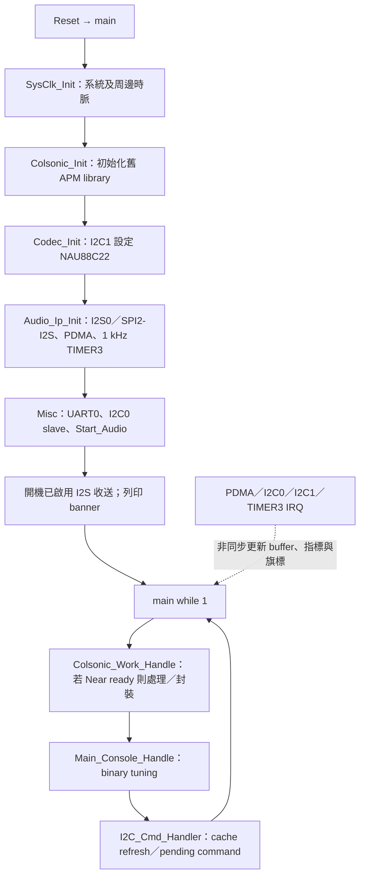
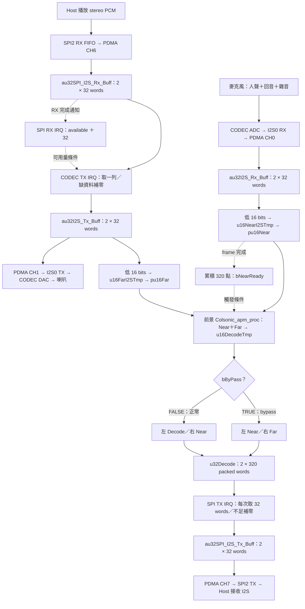
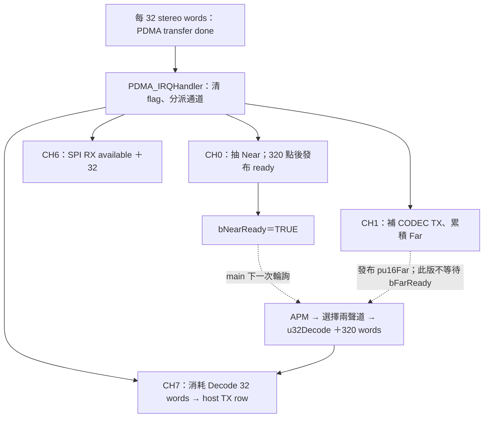
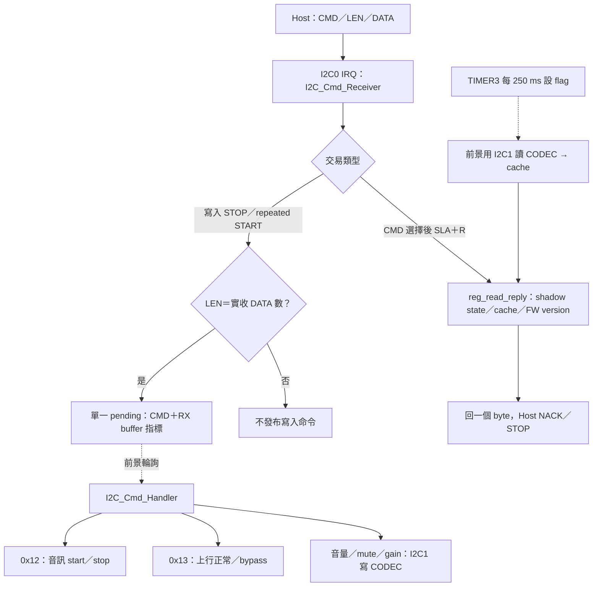

# 舊版 NAU88C22：I2C 控制與 I2S 音訊完整流程

## 1. 本範例做什麼

[回到整包 README](../../README.md) ｜ [對照 USB 範例](Nuvoton_demo_AEC_16k_0.0.2a.md)

本範例是 embedded host 與 NAU88C22 之間的音訊橋接器。Host 經 **SPI2 的 I2S 模式**送入背景播放 PCM；MCU 轉送給 CODEC 喇叭，同時抽出 Far 參考。麥克風經 CODEC ADC 回到 MCU 作為 Near；前景呼叫 Colsonic APM 後，將指定的兩個觀察聲道送回 host。

**I2C0 只傳控制命令，音訊由 I2S 傳輸。** 這個範例雖沿用 `UAC_RATE`、`usb_audio_def.h` 及部分 USB 結構名稱，目前啟動流程沒有啟動 USB UAC。現行 `setting.h` 選 `USB_EVB_SPI2_I2S`、`NAU88C22`、16 kHz／16-bit；SPI1、DMIC 等其他支線不是本文件的作用中音訊來源。

### 硬體介面

| 介面 | MCU 角色與對象 | 目前 pin／設定 |
|---|---|---|
| I2S0 | Master，連接 NAU88C22 音訊 | MCLK PD2、LRCK PD3、DI PD4、DO PD5、BCLK PD6；16 kHz stereo／16-bit，MCLK 要求為 `rate*256` |
| I2C1 | Master，設定／讀取 NAU88C22 registers | SCL PD0、SDA PD1；codec 7-bit 位址 `0x1A` |
| SPI2-I2S | **Master**，連接 embedded host 音訊 | MISO PA7、MOSI PA8、SS/LRCK PA9、CLK/BCLK PA10；I2S stereo／16-bit。`main.c` 亦列 PA12 MCLK，但目前 `SPI2_I2S_Init()` 沒有明確啟用 SPI2 MCLK；MCLK 輸出狀態另依板級設定確認 |
| I2C0 | Slave，接收 host command | SCL PD14、SDA PD15；開啟 `0x15/0x35/0x55/0x75` 四個 7-bit address，均指向同一 parser；初始化參數 100 kHz |
| UART0 | binary APM tuning＋既有 `printf` | TX PB8、RX PB9，115200 baud；tuning 與 log 共用同一介面 |

## 2. 開機與前景工作



`Start_Audio()` 重新設定 I2S／PDMA、清 FIFO、開啟 CODEC 與 host 的 TX/RX/DMA、重設 Near／Far／Decode frame 索引，最後發布 `g_bStreaming=START`。`Stop_Audio()` 關閉上述傳輸、清相關索引與計數、重新呼叫 `Colsonic_apm_init()`，最後發布 `g_bStreaming=STOP`。開機自動啟動與 I2C command 共用同一組 lifecycle 函式；`0x12` 回讀最近完成的軟體啟停狀態。

## 3. 端到端 DATA FLOW



此圖實線表示 PCM 資料路徑，虛線表示通知或執行條件；ready／available 本身不承載音訊。

### 下行：Host → 喇叭，同時建立 Far

1. SPI2 RX PDMA 直接把 host 的 stereo PCM 寫入 `au32SPI_I2S_Rx_Buff[0/1]`。完成 IRQ 的 `pdma_spi_i2s_rx_handler()` 只增加 32 words available，沒有再複製音訊。
2. `pdma_i2s_tx_handler()` 準備下一輪 CODEC TX row：若 SPI RX 至少有 32 words，複製整列 128 B；消耗該列並切換 SPI RX read row。若資料不足則將 CODEC TX row 清零。內部 `bI2S_Tx_Mute` 為真時也清零，但仍消耗 host 資料。
3. I2S0 TX PDMA 將該 row 送入 CODEC，再由 DAC／喇叭播放。取樣 Far 的位置是**準備好的 TX RAM row 低 16 bits**，所以補零／digital mute 也反映在 Far；不是從麥克風或 USB 另取參考。
4. 每 32 點累積至 `u16FarI2STmp`；達 320 點時發布 `pu16Far`、`bFarReady`，換另一列。Far 是 codec gain／speaker mute 之前的數位資料；codec 類比輸出音量不會回寫此 RAM。

### Near → APM → 上行

1. CODEC ADC 的 stereo word 經 I2S0 RX PDMA 寫入 `au32I2S_Rx_Buff`。
2. `pdma_i2s_rx_handler()` 每列取低 16 bits，累積至 `u16NearI2STmp`；每 320 點發布 `pu16Near`／`bNearReady`。
3. 前景 `Colsonic_Work_Handle()` **只檢查 Near ready**，沒有同時等待或清除 `bFarReady`；將當時 `pu16Near`、`pu16Far` 傳給 APM。開機 fallback 指標先指向 `u16DecodeTmp`，不等於已收到有效 Far frame。
4. APM 輸出 `u16DecodeTmp`，前景才依模式封裝 `u32Decode`，available 增加 320 words、寫入列切換。
5. `pdma_spi_i2s_tx_handler()` 每次從連續 640-word 範圍取 32 words，讀索引循環，填入 host TX row；不足 32 words 時整列補零、不扣除 Decode available。SPI2 TX PDMA 最後送給 host。

**Near／Far 都是 20 ms 分塊，不代表兩者具有已驗證的同一時間起點。** Far 在 CODEC TX refill 時計算，還有 ping-pong 排程及聲學路徑延遲；本版沒有 frame sequence 或時間戳校對。

## 4. 聲道與 RAM／PDMA 對照

| 模式 | 左／低 16 bits | 右／高 16 bits | 中間 RAM → 最終 PDMA |
|---|---|---|---|
| 正常，預設 `0x13=1` | `u16DecodeTmp[i]`：Decode | `pu16Near[i]`：Near | `u32Decode` → `au32SPI_I2S_Tx_Buff` → SPI2 TX |
| bypass，`0x13=0` | `pu16Near[i]`：Near | `pu16Far[i]`：Far | 同上 |

這是**舊 I2C 專案的排列**：正常是 Decode／Near，與舊 USB 正常的 Near／Decode 相反。`bypass` 沒有跳過 APM，並非獨立關閉 NR；只是傳回不同訊號供觀察。

| Buffer／descriptor | 容量 | 產生者 → 消耗者 | 計數／索引 |
|---|---|---|---|
| `au32SPI_I2S_Rx_Buff[2][32]`／`DMA_SPI2I2SRXDESC` | 256 B；每列 2 ms | CH6 PDMA → CODEC TX handler | `u16SPI_I2S_Rx_AvalCnt`＝words；read index＝row 0/1 |
| `au32I2S_Tx_Buff[2][32]`／`DMA_I2S0TXDESC` | 256 B；每列 2 ms | CODEC TX handler → CH1 PDMA；另抽 Far | `u8I2S_Tx_Buff_Index`＝row 0/1 |
| `au32I2S_Rx_Buff[2][32]`／`DMA_I2S0RXDESC` | 256 B；每列 2 ms | CH0 PDMA → CODEC RX handler | `u8I2S_Rx_Buff_Index`＝row 0/1 |
| `u16NearI2STmp[2][320]` | 1280 B；每列 20 ms mono | CODEC RX handler → `pu16Near` → APM／封裝 | `u16NearI2STmpWIdx`＝mono samples |
| `u16FarI2STmp[2][320]` | 1280 B；每列 20 ms mono | CODEC TX handler → `pu16Far` → APM／封裝 | `u16FarI2STmpWIdx`＝mono samples |
| `u16DecodeTmp[320]` | 640 B，20 ms mono | APM → 前景封裝 | 每次 320 點 |
| `u32Decode[2][320]` | 2560 B；共 640 words | 前景寫 320 → SPI TX handler 取 32 | `u16DecodeAvalCnt`／`u16DecodeBufRIdx`＝stereo words |
| `au32SPI_I2S_Tx_Buff[2][32]`／`DMA_SPI2I2STXDESC` | 256 B；每列 2 ms | SPI TX handler → CH7 PDMA | `u16SPI_I2S_Tx_Buff_WriteIndex`＝row 0/1 |

descriptor 0／1 互相鏈結，搬移寬度為 32 bits，TX 為 RAM 遞增→固定 FIFO，RX 為固定 FIFO→RAM 遞增。descriptor 儲存搬移設定，其指向的 PCM buffer 儲存音訊資料；固定位置見 `pdma_init.c`。



## 5. I2C 封包格式

原始碼：[command ID](Colsonic_16k_I2S_I2C/Util/i2c_cmd.h)、[IRQ parser／前景執行](Colsonic_16k_I2S_I2C/Util/i2c_handler.c)、[slave 初始化](Colsonic_16k_I2S_I2C/Util/init.c)。

本例使用 **7-bit address `0x15`**；要求 7-bit address 的 API 使用未左移的 `0x15`。線上 address byte 為 write `0x2A`／read `0x2B`。另外三個 address 是同一裝置的 alias，共用同一份狀態。

### 寫入

```text
START  [0x15 + W] ACK  CMD ACK  LEN ACK  DATA... ACK  STOP

範例：啟用正常輸出
送出的資料 bytes = 13 01 01
                         │  └─ DATA = 1
                         └──── LEN = 1；CMD = 0x13
```

所有需要值的現有 command 都用 `LEN=1`。Parser 在 STOP／repeated START 時核對 LEN 與實收 DATA 數量，成立才發布 pending command；**沒有 checksum，也沒有針對每個 command 檢查最低長度**。需要值的 command 若收到 LEN=0，可能讀到舊資料。`0x16/0x17` 的 DATA 不參與計算，操作範例統一使用 `LEN=1, DATA=0`。

此 parser 的 RX 長度限制與 NACK 邊界依上述短命令設計，沒有通用的大資料傳輸格式。I2C adapter 若自動加入 register／length，需將其計入實際線上 bytes，避免重複送入 `CMD/LEN`。

### 回讀一個 byte

```text
START [0x15 + W] ACK CMD ACK
REPEATED START [0x15 + R] ACK REPLY NACK STOP

例：選 CMD=19，回讀 firmware major 一個 byte。
```

讀之前只送 CMD，不送 LEN／DATA。`reg_addr` 保留所選 command，SLA+R 時回覆一個 byte；沒有連續多 byte register auto-increment。未支援的回讀回 `0xFE`。回覆的版本是 `Platform.h` 的 firmware 定義，不是 `.lib` 的版本查詢。



**I2C ACK 只代表 byte 傳輸被接收，不代表控制動作已完成。** Pending 只有一格且直接指向可重用 RX buffer；前景完成前若又開始下一筆寫入，可能覆蓋命令／參數。Host 逐筆操作並留出處理時間，音量 up/down 依 cache 更新後的回讀值確認。此版沒有 busy／transaction ID／執行完成握手，連續寫入的可靠性受前景排程限制。

## 6. 現有 command 完整表

下表數字均為十六進位 ID；DATA 值以 `0/1` 或 hex 範圍表示。正常值寫入皆為 `CMD 01 DATA`。左右 codec register 通常以相同值寫入，回讀音量只取左側 cache，並非兩個 byte 的 stereo 回覆。

| CMD／名稱 | 寫入 DATA／動作 | 回讀一個 byte | 影響／注意事項 |
|---|---|---|---|
| `0x12 SYS_CMD` | `0` Stop、`1` Start；只在目標狀態與目前完成狀態不同時呼叫 stop/start | `g_bStreaming`，0/1 | 控制 CODEC＋host I2S／PDMA；Stop 同時重新初始化 APM。Lifecycle 完成後才更新狀態；開機自動啟動完成後為 1 |
| `0x13 AEC_NR_CMD` | `0` bypass、`1` 正常，預設 1 | `g_bAEC`，0/1 | 呼叫 `Set_AEC_ByPass()`；選 Near/Far 或 Decode/Near，**不是獨立 NR enable** |
| `0x14 DAC_VOLUME_CMD` | `00..FF` 原始 DAC volume code，OR update bit `0x100` | 左 DAC cache byte `[1]` | 寫 codec `0x0B/0x0C`，影響播放輸出；不是 APM 參數 |
| `0x15 SPKOUT_VOLUME_MUTE_CMD` | `0` unmute、`1` mute | `g_bMute`，0/1 | 改 codec `0x36/0x37` bit 6；不呼叫 `Set_I2S_Tx_Mute()`，Far RAM 仍可能有播放 PCM |
| `0x16 SPKOUT_VOLUME_UP_CMD` | DATA 忽略；依左 speaker cache 低 6 bits 加一，最多 `3F` | 不支援，`FE` | 寫 `0x36/0x37`；使用 `16 01 00`，以 `0x1E` 確認音量 |
| `0x17 SPKOUT_VOLUME_DOWN_CMD` | DATA 忽略；依左 speaker cache 低 6 bits 減一，最少 `00` | 不支援，`FE` | 寫 `0x36/0x37`；使用 `17 01 00` |
| `0x18 ADC_VOLUME_CMD` | `00..FF` 原始 ADC volume code，OR `0x100` | 左 ADC cache byte `[1]` | 寫 `0x0F/0x10`，影響進入 Near 的麥克風資料 |
| `0x19 DSP_FW_VER_MAJ_CMD` | 沒有寫入實作 | `DSP_VER_MAJOR`，目前 `00` | Read-only；來源 `Library/Device/Nuvoton/I94100/Include/Platform.h` |
| `0x1A DSP_FW_VER_MIN_CMD` | 沒有寫入實作 | `DSP_VER_MINOR`，目前 `01` | Read-only；與 APM library binary 版本不是同一件事 |
| `0x1B ALC_CMD` | 編譯啟用後才有：`0` off、`1` on | 啟用後回 `g_bALC` | **目前 `CODEC_ALC_FUNC` 未定義，command 不存在**；目前讀為 `FE`，寫不執行控制 |
| `0x1C SPKBST_CMD` | `0` disable、`1` enable，shadow 預設 1 | `g_bSpkBst`，0/1 | 依 cache 修改 codec `0x31` bit 2，屬 speaker boost |
| `0x1D PGA_GAIN_CMD` | `00..3F`，實際以 `&3F` 取低 6 bits | 左 PGA cache byte `[1] & 3F` | 寫 `0x2D/0x2E`，影響麥克風 input PGA |
| `0x1E SPKOUT_VOLUME_GAIN_CMD` | `00..3F`，實際以 `&3F` 取低 6 bits | 左 speaker cache byte `[1] & 3F` | 寫 `0x36/0x37`，直接指定 speaker gain code |

DAC／ADC／PGA／speaker code 是 **register 原始索引**，不是百分比或本文已驗證的 dB。超範圍的 gain 值以 mask 截取，不是飽和到最大值。需依 codec 規格及實際板子音量配置解讀。

### 操作例：只列 I2C address 以後的 DATA bytes

```text
12 01 01    Start：已啟動時維持執行，不重新初始化傳輸
13 01 01    正常上行：左 Decode、右 Near
13 01 00    bypass 上行：左 Near、右 Far
13 01 01    回到正常上行
15 01 01    CODEC speaker mute
15 01 00    CODEC speaker unmute
16 01 00    Speaker gain code +1（依 cache 更新後的回讀值確認）
17 01 00    Speaker gain code -1
12 01 00    Stop：關閉串流並重設 APM
```

每行為一筆獨立交易，交易間保留前景處理時間。`0x14/0x18/0x1D/0x1E` 的設定值以板級配置為基準；ADC／PGA／speaker gain 也會改變 AEC 的訊號條件。

## 7. 控制狀態與操作限制

| 現況 | 實際影響／驗證方式 |
|---|---|
| 開機自動 `Start_Audio()` 完成後，`g_bStreaming=START` | 讀 `0x12` 為 1；第一筆 `12 01 00` 即執行 Stop，完成後回讀為 0。再次 Start 完成後為 1，重複目前狀態的指令不重啟。狀態使用 `volatile` 供前景與 I2C0 IRQ 共用，表示已完成的軟體狀態 |
| Timer 每 250 ms 要求更新 codec cache，前景才執行 | 音量回讀不是立即讀硬體；前景忙碌或 codec timeout 時會更久，開機未完成首輪讀取可能是 0。250 ms 不是保證完成時間 |
| `0x15/0x1C/0x1D/0x1E` 等從 cache `[0]` 組合寫值，但回讀／up/down 多取 `[1]` | Cache 來自 `NAU88C22_Read(..., 2 bytes)`；位元保留情形以 codec 原始 register readback 為準，command shadow state 僅表示軟體設定值 |
| `bNearReady` 單獨觸發 APM | 沒有證明 Near／Far 的 frame 對齊；前景太慢時旗標與雙 buffer 仍可能覆寫／遺失 |
| `u32Decode` 只有 640 words，SPI RX 只有兩列 | 缺資料會補零，但沒有完整 overflow guard；available 不是歷史遺失統計 |
| `#define DEBUG` 與 banner／command `printf` 仍存在 | I2C 回讀等路徑也可能在 IRQ 中列印；UART0 同時作 tuning，log 及耗時均可能影響測試 |
| `Main_Console_Handle()` 是作用中版本 | I2C parser 在存取 `p_rx[rlen-2]` 前沒有 USB 版的 `rlen<4` 檢查，短封包長度防護不完整 |

## 8. 原始碼索引

| 檔案 | 閱讀重點 |
|---|---|
| [main.c](Colsonic_16k_I2S_I2C/main.c) | 初始化順序、banner、前景三個 handler |
| [setting.h](Colsonic_16k_I2S_I2C/setting.h) | SPI2、codec、rate／bit 等目前選項 |
| [misc.c](Colsonic_16k_I2S_I2C/Util/misc.c) | APM 呼叫、聲道封裝、Start／Stop、bypass／digital mute |
| [data_handler.h](Colsonic_16k_I2S_I2C/Util/data_handler.h)、[buf_def.h](Colsonic_16k_I2S_I2C/Util/buf_def.h) | Buffer 型別、大小、索引單位 |
| [pdma_handler.c](Colsonic_16k_I2S_I2C/Util/pdma_handler.c)、[pdma_init.c](Colsonic_16k_I2S_I2C/Util/pdma_init.c) | 每 2 ms 的複製／補零／frame 發布、硬體 descriptor |
| [irq_handler.c](Colsonic_16k_I2S_I2C/Util/irq_handler.c) | PDMA、timer、I2C0／1 分工 |
| [codec.c](Colsonic_16k_I2S_I2C/Util/codec.c) | NAU88C22 初始化表與 codec I2C transaction |
| [colsonic_para_set.c](Colsonic_16k_I2S_I2C/Colsonic/colsonic_para_set.c) | UART binary tuning 的檢查與參數派送 |

APM library、profile、memory pool 與 module 表均與 USB 範例一致，配置及一致性檢查方式見整包 README。I2C/I2S 的聲道封裝、Near ready 觸發與 host 控制方式依本文件執行。
