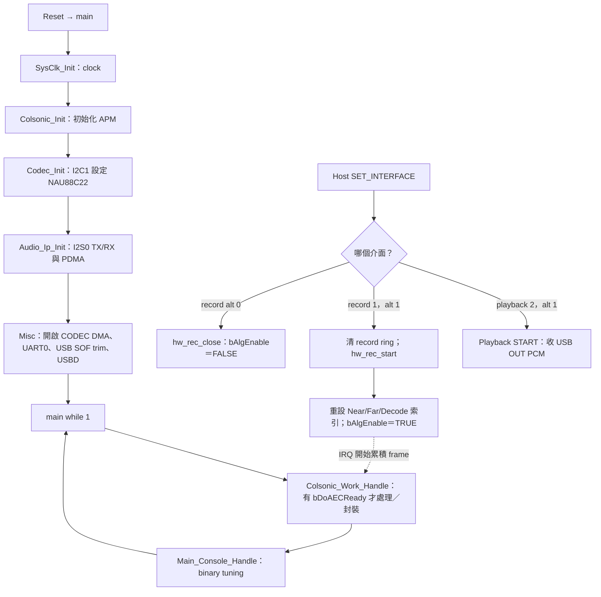
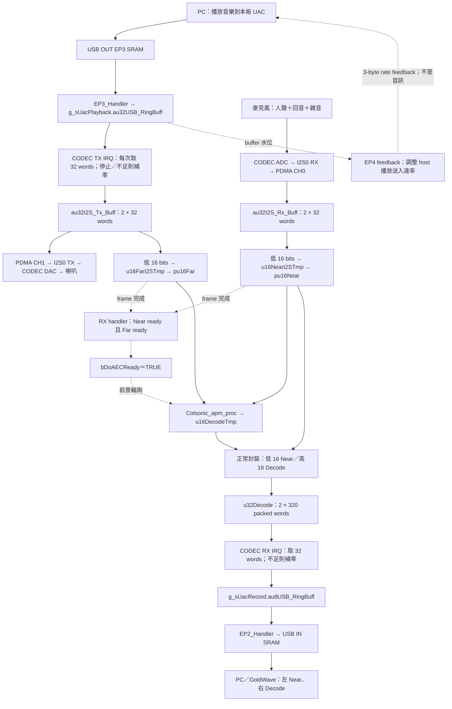
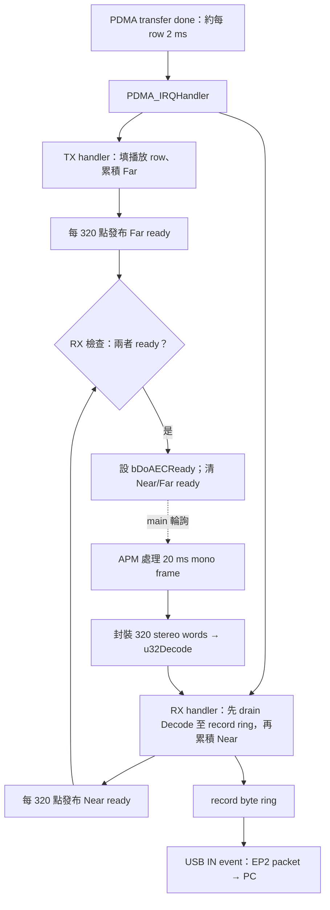

# 舊版 NAU88C22：USB UAC 與 AEC/NR 完整流程

## 1. 本範例做什麼

[回到整包 README](../../README.md) ｜ [對照 I2C/I2S 範例及 command](Colsonic_16k_I2S_I2C.md)

本範例讓 PC 將板子當成 USB 音效裝置：PC playback 送音樂給 CODEC 喇叭，板子同步取得數位播放 Far 與麥克風 Near，執行 Colsonic APM，再以 USB record 將**左 Near、右 Decode**送回 PC。GoldWave 等錄音軟體可同時觀察處理前與處理後的訊號。

目前 `setting.h` 選 `NT_I941`／`NAU88C22`、`NEAR_END_DMIC=0`、16 kHz／16-bit；USB playback／record 均為 2 channels。Near 實際來自 CODEC 的 I2S0 RX，沒有使用 DMIC。應用程式沒有語音轉文字／喚醒詞辨識流程，也沒有啟用 I2C0 host command slave。

| 介面 | 角色／目前設定 |
|---|---|
| USB device | PC 為 host；record interface 1、playback interface 2；alt 1 開啟、alt 0 關閉 |
| USB 音訊端點 | `EP3` playback OUT、`EP2` record IN、`EP4` playback feedback IN；`EP0/EP1` 為 control |
| USB pins | PB13 D−、PB14 D＋、PB15 VBUS |
| I2S0 | MCU master，CODEC slave；PD2 MCLK、PD3 LRCK、PD4 DI、PD5 DO、PD6 BCLK |
| I2C1 | MCU master 設定 NAU88C22；PD0 SCL、PD1 SDA；不是 PC 的音訊入口 |
| UART0 | PB8 TX、PB9 RX、115200 baud；binary APM tuning 與既有 `printf` 共用 |

## 2. 開機、Host 開串流與前景工作

開機 CODEC I2S DMA 已運作，但 `bAlgEnable` 預設為 FALSE；**只播放音樂而未開啟 USB recording 時，不會收集 APM frame**。`hw_rec_start()` 重設 frame／queue 狀態才啟用 Near／Far 收集；`hw_rec_close()` 關閉收集，不會把 CODEC DMA 或獨立 playback 一起關掉。

`hw_play_reset/start/close()` 在本版為空 callback；實際 playback state／ring 管理在 `AudioClass.c`。本例 `main.c` 未列印 I2C 版的開機 banner；`Main_Console_Handle()` 仍在每次 main loop 呼叫，UART parser 與 banner 列印是獨立行為。

## 3. 端到端 DATA FLOW

此圖實線表示 PCM 資料路徑，虛線表示 ready 通知、觸發條件或速率 feedback；APM 直接透過 Near／Far 指標讀取 RAM，音訊不會存進旗標。

### 下行：USB playback → CODEC → Far

1. `USBD_IRQHandler()` 分派 EP3 OUT event。`EP3_Handler()` 從 USB endpoint SRAM 取 payload，將 byte 長度右移 2 換成 `uint32_t` stereo word 數，寫入 playback ring。
2. `pdma_i2s_tx_handler()` 在 I2S0 TX 完成時準備一列 32 words。Playback 為 STOP 或 ring 不足 32 words 時整列清零；有資料則讀取 ring、更新 read index／available。
3. PDMA 將 `au32I2S_Tx_Buff` 送進 CODEC I2S0 TX，由 DAC／喇叭播放。`bAlgEnable` 開啟時，同一個**準備好的 TX row**低 16 bits 累積到 Far；每 320 點發布 `pu16Far`／`bFarReady` 並換列。
4. Far 是 CODEC DAC／speaker gain 與聲學路徑之前的數位參考。Playback 停止／underrun 的補零會進入 Far；它不是喇叭類比輸出的回讀，也不是 RX 麥克風聲音。

### Near → APM → USB record

1. CODEC ADC 經 I2S0 RX PDMA 寫 `au32I2S_Rx_Buff`。`bAlgEnable` 為真時，RX handler 每次抽低 16 bits 共 32 點作 Near；每 320 點發布 `pu16Near`／`bNearReady`。
2. **在 RX handler 裡**檢查 Near 與 Far ready；兩者都成立時設 `bDoAECReady=TRUE`，同時清 Near／Far ready。此版與 I2C 只等 Near 的條件不同。
3. 前景 `Colsonic_Work_Handle()` 呼叫 `Colsonic_apm_proc(Near, Far, u16DecodeTmp)`。短暫遮蔽 PDMA IRQ 清 `bDoAECReady`，然後將左 Near／右 Decode 寫進 `u32Decode`，增加 320 words available。
4. 同一個 `pdma_i2s_rx_handler()` 還負責消耗**之前已產生**的 `u32Decode`：每次取 32 words＝128 B，寫入 USB record byte ring；不足時寫入 128 B 的零。RX handler 先 drain 已有輸出，再收集當輪 Near，APM 另於前景依 320 點 frame 處理。
5. Record state 為 START 時，record ring 累積至一半容量後變成 BUSY。`EP2_Handler()` 在 BUSY 狀態從 byte ring 複製資料到 USB SRAM，排定下一個 IN payload，最後送回 PC。未到 BUSY 時為 zero-length payload；ring 不足時補零。

這裡使用的是雙 buffer＋ready 旗標，沒有時間戳／frame sequence 配對；「兩個 ready」不等於已證明時間完全對齊。Far 的計算時點是 TX refill，不是已量測的類比播放時間。

## 4. 聲道、RAM、PDMA matrix

| 模式 | PC 左／word 低 16 bits | PC 右／word 高 16 bits | 封裝與目的地 |
|---|---|---|---|
| 正常，預設 | `pu16Near[i]`：處理前麥克風 | `u16DecodeTmp[i]`：處理後 | `(Decode << 16) \| Near` → `u32Decode` → USB record ring → EP2 |
| 原碼內部 bypass 分支 | `pu16Far[i]`：數位播放參考 | `pu16Near[i]`：處理前麥克風 | `(Near << 16) \| Far` → 同上 |

`bAlgByPass` 靜態初值為 0，現有程式沒有 command 將它設為 1；此表列出原碼的內部分支，USB 並未提供可操作的 bypass 功能。即使走該分支，APM 仍先執行。此 USB 範例沒有 I2C `0x13` 控制入口。

| Buffer／descriptor | 大小、時間 | 產生者 → 消耗者 | 計數單位 |
|---|---|---|---|
| USB EP3 SRAM | USB OUT payload；16 kHz stereo/16-bit 名目每 1 ms 64 B | USB device 硬體 → EP3 handler | USB payload＝bytes；handler 轉 words |
| `g_sUacPlayback.au32USB_RingBuff[240]` | 960 B，15 ms stereo 容量 | EP3 handler → CODEC TX handler | read/write index、`u16AvalCnt`＝words |
| `au32I2S_Tx_Buff[2][32]`／`DMA_I2S0TXDESC` | 256 B，每列 128 B／2 ms | CODEC TX handler → PDMA CH1／I2S0 TX；另供 Far | row＝0/1；每列 32 words |
| `au32I2S_Rx_Buff[2][32]`／`DMA_I2S0RXDESC` | 256 B，每列 2 ms | PDMA CH0／I2S0 RX → CODEC RX handler | row＝0/1；每列 32 words |
| `u16NearI2STmp[2][320]` | 1280 B，每列 20 ms mono | RX handler → `pu16Near` → APM／封裝 | WIdx＝mono samples |
| `u16FarI2STmp[2][320]` | 1280 B，每列 20 ms mono | TX handler → `pu16Far` → APM | WIdx＝mono samples |
| `u16DecodeTmp[320]` | 640 B，20 ms mono | APM → 前景封裝 | 320 signed PCM samples，以 `int16_t *` 傳入 |
| `u32Decode[2][320]` | 2560 B，共 640 stereo words／40 ms 容量 | 前景每次寫 320 → CODEC RX handler 每次取 32 | `u16DecodeAvalCnt`、`u16DecodeBufRIdx`＝words |
| `g_sUacRecord.au8USB_RingBuff[2560]` | 2560 B，40 ms stereo 容量 | CODEC RX handler → EP2 handler | read/write index、`u16AvalCnt`＝bytes |
| USB EP2 SRAM | 名目 64 B，依水位為 56／64／72 B | EP2 handler → USB device 硬體 → PC | bytes |

Near／Far 指標指向 frame 列，沒有額外拷貝。`u32Decode` 是 CPU 管理的 stereo 佇列，不直接作為 USB 或 I2S DMA 的目的／來源；USB 路徑由 CPU handler 複製 SRAM 與 RAM。

### USB 水位與 feedback 的目的

| 機制 | 本設定的實際數值 | 原碼行為 |
|---|---|---|
| Playback START→BUSY | 寫入索引達 `240/2=120 words` | EP3 依 **write index** 判斷；CODEC TX 對非 STOP 已可消耗資料，剩餘緩衝量依 available 計數判斷 |
| Playback 水位 | Low 80 words／5 ms；High 160 words／10 ms | EP4 回傳 3-byte rate feedback：低水位提高要求量、高水位降低要求量 |
| Playback BUSY ring 滿 | 只接受 free capacity | 超出容量的 packet 尾端 words 不寫入，無累計 drop 統計 |
| Record START→BUSY | `2560/2=1280 bytes`＝20 ms 容量 | RX handler 寫入處理結果或零，累積一半才開始 BUSY record |
| Record 水位 | Low 1280 B、High 1920 B | EP2 在低／中／高水位分別送 56／64／72 B，調節消耗速度 |
| Record ring 為空 | EP2 補零 | 不代表 Near 或 APM 必然沒有聲音，也可能是前一段供應不足 |

這些控制處理 USB 與音訊時脈的資料量差異；**EP4 傳送速率 feedback**。Ring 容量表示最大儲存量，實際排隊延遲依水位與排程決定。

## 5. 每 2 ms／20 ms 的程式分工

Scatter-gather descriptor 0／1 互相鏈結，硬體進下一列時 IRQ 處理完成列。每列是 **32 個 32-bit stereo words＝128 B**；10 列累積成一個 320 點 mono APM frame。

只有清 ready 時短暫遮蔽 IRQ，不代表整段 APM 輸入 buffer 被鎖住；前景若超過 frame 時間，仍可能被下一輪 IRQ 換指標或覆寫。`u32Decode` 與 record ring 也沒有完整 overflow 保護與 drop 統計。本文件描述目前排程，未宣稱已完成即時性或長時間壓力驗證。

## 6. 控制與 UART 行為

- USB `AUDIO_SetInterface()` 依 host 開關 playback／record，兩者相互獨立；錄音開啟才啟用 APM。
- `AUDIO_ClassRequest()` 處理 USB class 的取樣率、mute、volume 等 control request；接受／回覆 control 欄位不代表每項都已映射成 codec 或 PCM 處理，實際作用依 control 到 codec／PCM 的連接路徑判定。
- `Main_Console_Handle()` 是作用中的 UART binary tuning parser，檢查封包頭尾／checksum／長度，經 `colsonic_setpara_proc()` 等 API 派送 library 參數。UART IRQ 收 bytes，main loop 處理封包，不傳送這裡的 PCM。
- UART0 也承載既有 `printf`，可能混入 tuning 回覆；UART parser 的執行不依賴開機 banner。

## 7. GoldWave 初次觀察方式

1. PC 的播放裝置與錄音裝置均選這片板子的 USB UAC；錄音選 16 kHz、16-bit、stereo。播放若走 PC 自己的喇叭，板子 Far 不一定含那段音樂。
2. 先錄「只播放背景音」：左 Near 應含麥克風收到的喇叭聲，右 Decode 為處理結果。再加入現場人聲，觀察雙講時人聲及背景是否一同改變。
3. 分別 solo 左／右聲道比較。右聲道仍可能有殘餘背景；左右不是兩個獨立麥克風，也不是直接代表「音樂／人聲」。
4. 原碼 Far 只取 CODEC TX 低 16 bits，沒有將 L/R 做 downmix。初次用左右相同的播放素材，避免音樂只在另一邊而 Far 缺少參考；若用 stereo 素材，需再核對實際 speaker routing。
5. 開頭零資料的來源包括 record START 預存、`u32Decode` 供應不足及 USB recording 尚未進入有效傳輸；各段狀態可依前述 buffer 路徑核對。

上述流程用於觀察訊號與控制狀態；降噪效果、雙講表現及端到端延遲取決於實際板級增益、播放／收音路徑與排程，需以板上錄音量測。

## 8. 原始碼閱讀索引

| 檔案 | 閱讀重點 |
|---|---|
| [main.c](Nuvoton_demo_AEC_16k_0.0.2a/main.c)、[setting.h](Nuvoton_demo_AEC_16k_0.0.2a/setting.h) | 啟動順序、main loop、目前 codec／Near source |
| [misc.c](Nuvoton_demo_AEC_16k_0.0.2a/Util/misc.c) | USB record callback、APM 與聲道封裝 |
| [AudioClass.c](Nuvoton_demo_AEC_16k_0.0.2a/Util/AudioClass.c) | USB IRQ、EP2／3／4、interface state 與 class request |
| [audio_desc.c](Nuvoton_demo_AEC_16k_0.0.2a/Util/audio_desc.c)、[usb_audio_def.h](Nuvoton_demo_AEC_16k_0.0.2a/Util/usb_audio_def.h) | Host 看見的格式／介面、ring 長度與 thresholds |
| [data_handler.h](Nuvoton_demo_AEC_16k_0.0.2a/Util/data_handler.h)、[buf_def.h](Nuvoton_demo_AEC_16k_0.0.2a/Util/buf_def.h) | RAM buffer、word／byte 單位與 frame 長度 |
| [pdma_handler.c](Nuvoton_demo_AEC_16k_0.0.2a/Util/pdma_handler.c)、[pdma_init.c](Nuvoton_demo_AEC_16k_0.0.2a/Util/pdma_init.c) | 每列複製／補零、Near/Far ready、scatter-gather |
| [irq_handler.c](Nuvoton_demo_AEC_16k_0.0.2a/Util/irq_handler.c)、[init.c](Nuvoton_demo_AEC_16k_0.0.2a/Util/init.c) | PDMA dispatch、clock／pin／I2S／UART 初始化 |
| [codec.c](Nuvoton_demo_AEC_16k_0.0.2a/Util/codec.c) | CODEC register 初始化 |
| [colsonic_def.c](Nuvoton_demo_AEC_16k_0.0.2a/Colsonic/colsonic_def.c)、[colsonic_para_set.c](Nuvoton_demo_AEC_16k_0.0.2a/Colsonic/colsonic_para_set.c) | APM 記憶體／module 設定與 UART tuning |

USB 與 I2C 範例使用相同的 library binary、profile、148000 B APM pool 與 module 表；雜湊及一致性檢查方式見整包 README。USB descriptor、record／playback 控制與聲道封裝依本文件的路徑運作。
